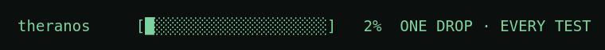
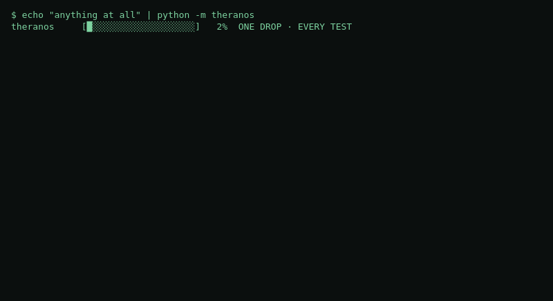

# theranos

A Python library that runs every test on anything, from one drop.



```python
from theranos import edison

report = edison({"patient": "you"})
print(report)
report["__contains__"].verdict     # 'WITHIN OUR RANGE'
```

`edison()` accepts ints, dicts, `None`, sockets, functions, the module itself —
any object at all. It reports a full panel for every attribute it can see, from
one drop, in four hours, with a proprietary process. One panel per report is
always voided, because that is what accuracy looks like.

It also animates a progress bar while it thinks, with our wordmark capitalizing
letter by letter, in a loop, so that you can see the work happening. The bar
measures nothing. Neither did the machine.

Silence it with `EDISON_QUIET=1` or `edison(x, show=False)`.

```bash
python -m theranos                                   # the showcase
python test_theranos.py                              # or: pytest
echo "anything" | python -m theranos                  # pipe it in
grep -r secret . | python -m theranos                # it consumes the stream
cat /dev/urandom | python -m theranos                # it consumes that too
```

Piped input is reported on directly: the stream itself becomes the subject, with
a panel for each of its attributes, without a byte of it being read. Reading is
proprietary.



No dependencies. Every result is fabricated, deterministically: same input, same
numbers, every time — because reproducibility is the foundation of trust.

Validated internally. Not for diagnostic use, or any use. Not FDA cleared, not
FDA reviewed, not FDA aware.

## License

MIT — see [LICENSE](LICENSE).

**Commercial use.** The license permits you to sell this. We would rather you
didn't. Should you sell it anyway, the customary fee is one drop of blood,
payable in arrears, non-refundable.

The name and marks referenced in this project belong to their respective owners
and are used nominatively, in satire. This is a parody; there is no affiliation
with any company, living or dissolved.
